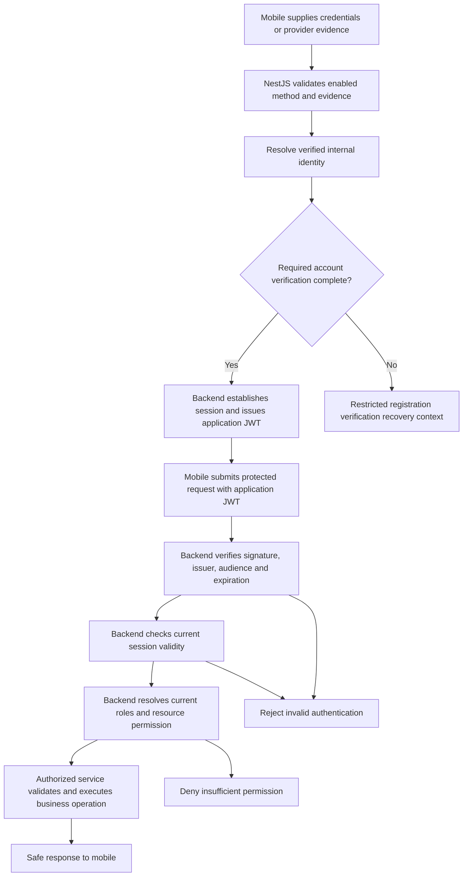

# AAYUVYA — Authentication and Authorization Implementation Plan

## 1. Purpose, authority and planning status

| Item | Value |
| --- | --- |
| Created | 2026-10-12, Asia/Calcutta date context |
| Status | Implementation-planning draft; no application implementation is performed or authorized by this document |
| Primary requirements source | [specifications.md](specifications.md), including its evidence classifications, stories, requirements, clarification register and supplied proposals |
| Mandatory engineering authority | [constitution.md](constitution.md), version 1.0.0; ratified and amended 2026-10-02 |
| Primary stories | US-002 — enabled authentication; US-003 — identity continuity and association; US-004 — logout and eligible recovery; US-017 — protected access |
| Supporting scope | Authentication prerequisites from US-001 and access enforcement for US-016; other business capabilities are integration consumers, not implementation scope here |
| Release | SRC-013 selects the bounded authentication planning slice; complete product Phase 1 and client commercial/legal/privacy/operational approval remain unresolved. |
| Platforms | Android and iOS smartphones are confirmed for the initial release; neither may be excluded without explicit approval. Minimum OS versions and representative device matrix remain NEEDS CLARIFICATION. |
| Feature identifier / branch | No approved implementation identifier or branch is available. `aayuvya-mvp-clarifications` identifies the supplied proposed resolution register, not a verified implementation branch. |
| Repository baseline | Documentation workspace: constitution.md, specifications.md and this plan. No application implementation is established by IDE tabs. Developer has Windows, a physical iPhone and no Mac. |

This plan explains how to organize, build and verify the selected stories within the approved stack. It does not change either source document, choose missing business policies, create schemas or code, install dependencies, or claim that implementation has passed tests.

### 1.1 Meaning of requirement and design status

**Current source:** specifications.md SRC-013 incorporates the 12 October 2026 Consolidated Clarification Decisions. It supersedes conflicting SRC-012 proposals. U denotes carried user direction; B denotes a selected planning baseline; P remains explicitly provisional. None is evidence of client commercial/legal/privacy/operational signoff. The existing constitution remains unchanged.

**Constitutional conflict:** Twilio-managed OTP generation/checking conflicts with the constitution's literal backend-generation/verification wording. The requested Twilio design is planned below, but implementation cannot be represented as constitution-compliant until CLR-024 is resolved. Proposed narrow wording: permit an approved verification provider to generate/check codes through NestJS, with NestJS retaining application identity, binding, rate-control, session and authorization authority. No local OTP fallback or automatic amendment is authorized.

- **Confirmed requirement:** a constitutional obligation or a confirmed user decision, corresponding to C or U in the specification. These constrain every applicable implementation.
- **Conditional requirement:** a safeguard or journey applies when its method, role or capability is enabled. A confirmed safeguard does not automatically enable the feature.
- **Supplied/derived proposal:** P/D values remain unapproved. SRC-013 supersedes the therapist proposal, ambiguous Android methods and optional phone-verification assumption. B selections such as rotating refresh and initial roles are concrete planning inputs with stated reviews still required.
- **Proposed implementation approach:** a technical design suggested in this plan to satisfy cited requirements. Unless explicitly marked mandatory by the constitution, component boundaries, model names, operation names and mechanisms below are proposals for technical review, not new product obligations.
- **NEEDS CLARIFICATION:** a missing business decision, security policy, approved parameter or technical selection. Dependent production behavior must not be filled in with a tutorial default, arbitrary configuration or guessed approval.

The existing specification retains P1/P2/P3 prioritization semantics and an unresolved P0/P1/P2 proposal. Delivery sequence below describes technical dependencies; it does not silently change story priorities or approve a release matrix.

### 1.2 Scope boundaries

Implementable planning coverage comprises enabled sign-in, stable internal identity, secure method association, session validity, logout, password recovery when enabled, role-based authorization, resource ownership, abuse prevention, safe errors and the corresponding mobile interactions.

Only the account information and profile operations needed to establish identity and prove ownership belong in the supporting US-001 slice. The full profile experience and administrative business tools remain separate stories. Do not create appointments, memberships, credits, payments, family/couple delegation, operator scheduling, passports or reporting to demonstrate authorization; use controlled fixtures and define how those future modules will enforce the shared policies.

MFA, biometrics as a sign-in method, passkeys, magic-link sign-in, device-management screens, self-service account merging, impersonation, unrestricted role editing and additional identity providers are not introduced. Logout-all-devices is now a planned security action subject to reviewed UX/policy, not an already approved production feature. A security mechanism such as request correlation or protected credential storage does not create one of those business capabilities.

## 2. Requirements baseline and traceability

### 2.1 Story coverage

| Story | Source obligations to deliver | Conditional or unresolved boundary | Planned coverage |
| --- | --- | --- | --- |
| US-002 | FR-003–FR-007; BR-001–BR-004; SEC-001, SEC-004–SEC-008, SEC-010–SEC-012; INT-001–INT-003 | Enabled methods per platform/role, credentials policy, providers and limits: CLR-003–CLR-004 | Backend method verification, identity resolution and sessions; mobile sign-in; Sections 4–8; DEL-003; VAL-002–VAL-005, VAL-016–VAL-018 |
| US-003 | FR-007–FR-009; BR-001–BR-003; SEC-008 | Normalization, association evidence, duplicate/conflict and lost-access handling: CLR-005 | Shared identity service, provider association constraints and secure linking operation; DEL-004; VAL-006 |
| US-004 | FR-010–FR-012, FR-053–FR-054; BR-004–BR-006; SEC-006–SEC-009; INT-006 where applicable | Selected rotating refresh and verified-email reset; provisional lifetimes and unresolved race/revocation effects: CLR-004–CLR-005 | Backend session revocation, expiry, password recovery; mobile restoration/logout; DEL-005; VAL-007–VAL-009, VAL-017, VAL-019 |
| US-017 | FR-042; BR-007; SEC-001–SEC-003, SEC-010–SEC-012 | Selected MEMBER/OPERATOR/ADMIN roles; unresolved action/ownership matrix and privacy boundaries; delegation deferred: CLR-006, CLR-017, CLR-021 | Authentication then authorization guards, current server-side permission evaluation and resource checks; all increments; DEL-006; VAL-010–VAL-012 |
| US-001, supporting only | FR-001–FR-002 where needed for account establishment; FR-008, FR-043, FR-047–FR-052; BR-008 | Self-service MEMBER registration, mandatory phone/email verification and pending restrictions selected; exact profile fields still open: CLR-002–CLR-005 | Approved registration prerequisites and ownership validation; DEL-002; VAL-001 |
| US-016, access boundary only | FR-040–FR-042 insofar as administrative access must be protected | Administrative operations and provisioning authority are not a complete approved action catalog: CLR-017 | Reject unauthorized administrative requests; test approved permission distinctions without building unrelated management tools; DEL-006; VAL-010 |

Shared requirements FR-043–FR-046 apply according to their specification status: validate input, expose truthful outcomes, prevent unintended repeated effects where approved, and preserve the integrity of defined related changes. Relevant quality requirements are NFR-001, NFR-003–NFR-008, plus NFR-002 where result collections are introduced. Relevant measurements are SC-001, SC-010, SC-012 and SC-013; recovery evidence also supports the applicable part of SC-011.

The relevant edge cases are EC-001–EC-013, EC-017 for denied unapproved delegation, EC-039–EC-042, EC-044–EC-051. Payment and notification business workflows are excluded except credential/recovery delivery under INT-003 and INT-006.

### 2.2 Mandatory technical constraints

| Constitutional area | Required implementation constraint | Planned compliance evidence |
| --- | --- | --- |
| Stack and architecture | React Native and TypeScript; NestJS and TypeScript on Node.js; modular monolith; PostgreSQL with Prisma and Prisma Migrate; REST; JWT; Swagger/OpenAPI | Architecture review and dependency manifest review when implementation exists; no alternative identity authority or replacement stack |
| Separation of concerns | Thin controllers, business logic in services, database access outside controllers, NestJS dependency injection, isolated external integrations, SOLID and cohesive responsibilities | Module/service review; injectable provider and persistence boundaries; behavior tests |
| Validation and API | DTOs with class-validator and class-transformer or explicitly approved equivalent; authoritative backend validation; consistent errors; documented REST contracts | Validation and authorization integration cases; synchronized OpenAPI |
| Database | Prisma Schema is the source of truth for a new database; appropriate keys, foreign keys, uniqueness, required values and indexes; transactions for inseparable operations; controlled reviewed migrations | Model/constraint review and isolated PostgreSQL integration tests; reviewed migration history |
| Identity and security | Backend authority; verified identities; safe credential handling; JWT verification; role and ownership enforcement; HTTPS; least privilege; no secrets or bypasses | Negative security cases, production-equivalent access tests, redaction and configuration review |
| Frontend | Centralized typed API/service layer, protected navigation, no direct database access or backend secrets, no authoritative client-only business rules | Mobile behavior tests against backend outcomes, secret scanning and device validation |
| Testing | Jest for backend; Supertest where appropriate for integration; Jest and React Native Testing Library for frontend; deterministic behavior tests with isolated external services | Success/failure/exception evidence per story; no production database in tests |
| Delivery and governance | Small logical changes; relevant tests and builds pass; lint/static analysis; security, integrity, performance and constitutional review | Per-increment completion gate in Section 10 |

No microservices, Redis, message broker, queue or caching layer is proposed. A later need requires documented justification and the approvals the constitution actually specifies. No constitutional exception or amendment is assumed. Exact runtime, framework, Expo SDK and package versions must be selected and compatibility-checked during technical review; no version is invented here.

## 3. Decision register and readiness boundaries

The following are implementation-planning decisions, not new product requirement identifiers. Refer back to the specification's CLR entries and SRC-013 status for decisions/review. SRC-013 identifies product-owner, technical and security/privacy responsibilities; named owners and actual signoffs remain open.

| ID | Decision / missing information | Confirmed boundary and proposed handling | Needed before / participant expertise |
| --- | --- | --- | --- |
| DEC-001 | Selected scope: US-002–US-004/US-017, only US-001 identity prerequisites and US-016 access boundary. | One story at a time; full product matrix/priorities/owners still NEEDS CLARIFICATION. Family/advanced/unrelated features excluded from this slice. | Scope review; CLR-001; product owner |
| DEC-002 | All four member methods planned; password/OTP/Google on Android/iOS, native Apple on iOS and approved non-Apple alternatives on Android. | Old “only Google” ambiguity superseded. Configuration fails closed; privileged-role method access and first implementation method remain NEEDS CLARIFICATION. | Method activation; CLR-003; technical/product owners |
| DEC-003 | Self-service member completion requires primary auth, verified phone, email verification for email/password and minimum approved profile. Pending access is limited. | E.164 normalization; no default mandatory demographics. Exact fields/bounds/age/email normalization and phone-country eligibility remain NEEDS CLARIFICATION. India market does not imply +91-only. | Registration; CLR-002; product/privacy |
| DEC-004 | Canonical internal identity; linking requires existing-account reauthentication and new-method proof; verified phone unique per member unless exception approved. | No unverified merges or self-service merging. Conflicts stop; assisted recovery needs authorized identity checks/audit. Evidence, recycled-phone and support workflow details remain NEEDS CLARIFICATION. | Identity/linking; CLR-005; product/security |
| DEC-005 | Password minimum 8; reject current-password reuse; maintained strong hash, never custom cryptography. | Hash algorithm/calibrated parameters, maximum length and character-count definition remain NEEDS CLARIFICATION. No extra composition/history default. | Credential implementation; CLR-004; security/technical |
| DEC-006 | Twilio Verify selected for SMS generation/checking; no application generation, storage or logging of codes. | Provisional: 5 failed checks, 60-second cooldown, 5 requests/phone/rolling hour. Provider expiry/resend/settings need review. CLR-024 must reconcile constitutional delegation wording. | All phone verification; CLR-004, CLR-024; security/technical governance |
| DEC-007 | Rate controls cover registration/login, OTP requests/checks, resets, provider exchange, linking and recovery; shared enforcement for multi-instance deployment. | Dimensions/limits for non-OTP actions, proxy trust and retention remain NEEDS CLARIFICATION; no permanent lockout/CAPTCHA/suspension policy invented. | External exposure; CLR-004, CLR-021; security/operations |
| DEC-008 | Proposed RS256 access JWT with 15-minute lifetime; verify signature/issuer/audience/expiry/not-before when present and required subject/session. | These values remain provisional. Issuer/audience, key storage/rotation/compromise handling and clock tolerance remain NEEDS CLARIFICATION; provider token never equals application token. | Token activation; CLR-004; security/technical |
| DEC-009 | Tracked sessions and persistent ordinary access; current logout revokes current session. Planned logout-all and security-event revocation. | Proposed 30-day inactivity and 5 active sessions/devices. Define activity, cap/eviction semantics, device meaning, security-event scope and in-flight races; no nonexpiring-token assumption. | Session acceptance; CLR-004; product/security |
| DEC-010 | Rotating session-bound refresh selected for persistent access; successful renewal invalidates prior credential; protected mobile storage and server verifier. | Reuse intends session/family revocation plus sign-in. Family boundaries, refresh lifetime, concurrent legitimate refresh/lost-response handling remain NEEDS CLARIFICATION/security review. | Renewal acceptance; CLR-004; security/technical |
| DEC-011 | Backend verifies Google/Apple trusted evidence and stable subject; configure platform client IDs/redirects; confidential credentials stay server-side. | Provider accounts/configurations remain NEEDS CLARIFICATION. EAS iPhone development build required for Google OAuth and other scheme/native flows needing it. | Provider/device tests; CLR-003, CLR-020; technical owner |
| DEC-012 | Verified-email reset authorization: 5 minutes, single-use, new request supersedes previous; non-enumerating requests. | Email vendor/configuration and registration-email verification expiry/resend/supersession remain NEEDS CLARIFICATION. All-session revocation and fresh sign-in after reset is proposed. Lost provider uses another verified method or authorized assisted recovery, never bypass. | Recovery; CLR-004–CLR-005; security/product |
| DEC-013 | Initial planning roles MEMBER, OPERATOR, ADMIN; public MEMBER only; controlled auditable privileged provisioning. No SUPER_ADMIN. | Production action/subject matrix, bootstrap authority and propagation/races remain NEEDS CLARIFICATION; deny by default with test-only fixtures until approved. | Privileges; CLR-017; product/security |
| DEC-014 | Backend identity, trusted roles and stored ownership; deny unknown permissions on individual and list results. | Family/couple delegation deferred; no implied foreign access from member IDs or relationships. Real resource grants remain subject to approved matrix. | Resource integration; CLR-006, CLR-017 |
| DEC-015 | Android/iOS, English, Windows/physical iPhone/no Mac. Expo Go initially for compatible work; EAS cloud development builds for required native/OAuth flows. | OS/device/accessibility test matrix, secure-storage package/version and developer/signing accounts remain NEEDS CLARIFICATION. Android emulator/device evidence required too. | Mobile acceptance; CLR-020; technical/accessibility |
| DEC-016 | India operating scope; data minimization, privacy/role limits, safe logs, separate essential messages/marketing consent. No minors/family/sensitive collection without policy. | Provisional retention: diagnostics 30 days, security/audit 180 days, privileged audit 2 years. Legal applicability, category overlap, consent/deletion/retention approvals remain NEEDS CLARIFICATION. | Production data policy; CLR-021; privacy/legal/security |
| DEC-017 | Repeatable story tests separate from production SLOs; failures cannot falsely authenticate; critical effects nonduplicating. | Provisional p95 API <500 ms excluding providers, common interaction <2 s, monthly availability 99.5%. Load, measurement definitions, RTO/RPO/support/delivery targets remain NEEDS CLARIFICATION. | Quality acceptance; CLR-022; client/operations |
| DEC-018 | No live Zoho integration. Client decides historical continuity; if needed use separately approved export/reconciliation. | No verification inferred from spreadsheet; no credential import without secure review. Import scope or explicit no-history decision remains NEEDS CLARIFICATION. | Production data readiness; CLR-023; product/data/security |

Decisions on algorithms, versions and secure storage are technical choices needed to satisfy existing requirements, not constitutional amendments unless they change a governed stack or architecture. Product-policy questions must be answered as policy; a technical reviewer cannot silently select a business default.

**Work independent of unresolved business policy:** architecture and interface review, request-authentication/authorization separation, validation/error structure, confidential logging, source traceability and test-fixture design. Future implementation of these foundations can use explicitly test-only fixtures with no production access path.

**Work requiring remaining decisions first:** constitutional Twilio reconciliation, production provider/security configuration, real privileges, unresolved profile/contact-recovery policy and reviewed session/refresh race behavior. Missing required security configuration must not silently fall back to permissive behavior. The proposed implementation refuses activation of the affected method or fails startup, as appropriate to the eventual deployment contract.

## 4. Proposed technical organization and trust boundaries

### 4.1 NestJS modular monolith

The modular monolith, NestJS dependency injection and thin controllers are mandatory. The following module/service decomposition is proposed and may be simplified during review without changing responsibilities:

| Responsibility | Proposed placement | Owns | Does not decide |
| --- | --- | --- | --- |
| Internal user identity | Identity module and identity-resolution service | Stable application identity, provider associations, approved contact normalization/verification state and association conflicts | Provider validity without verified evidence; business benefit eligibility |
| Authentication workflows | Authentication module and method-specific services | Enabled-method checks, password verification, Twilio-bound verification and email/reset authorizations, verified provider exchange and orchestration | User roles from submitted fields; unapproved account lifecycle |
| Sessions and token issuance | Session service within authentication initially | Session establishment, application JWT issue/validation support, logout/revocation and selected rotating refresh | Independent client authentication state; arbitrary policy lifetimes |
| Authorization | Authorization module with guards and injectable policy services | Role/action checks, approved ownership/delegation predicates and consistent denial | Authentication verification; undocumented administrator powers |
| Persistence | Prisma access service and focused data-access methods | Database constraints and atomic state transitions | Controller logic or external provider truth |
| External identity/delivery | Google/Apple verification, Twilio Verify and email verification/reset adapters injected into authentication services | Provider protocol details, permitted payloads, normalized verification/delivery outcomes | Internal user identifiers, role assignments or proof from delivery receipts |
| Shared operational safeguards | Configuration, DTO validation, logging and exception handling | Validated environment-specific settings, consistent safe errors and nonsecret correlation | New product analytics, manual support powers or approval policies |
| Mobile auth experience | React Native/Expo authentication area plus centralized API client | User input, interaction state, protected credential access and rendering server-confirmed results | Credential truth, granted roles, current session validity or resource permissions |

Authentication and authorization remain separate checks even when services share a module. A protected request cannot proceed merely because a JWT was decoded or an application screen is hidden. The proposed guard ordering is authentication first, authorization second; resource-specific checks also execute in the service that loads or changes the resource. NestJS documents separate authentication and authorization enforcement; package selection is left to technical review. [NestJS authorization documentation](https://docs.nestjs.com/security/authorization).

### 4.2 Authoritative request flow

The diagram is a proposed realization of the constitutional flow. It introduces no automatic provider account creation or grant of privileges. A valid provider token is input to authentication, not an AAYUVYA protected-resource credential. Backend identity and current authorization remain authoritative on every protected request.

### 4.3 Proposed access enforcement

1. Use a global authentication guard with an explicit, narrowly reviewed public-operation allowlist. Public credential-entry, challenge initiation or recovery request operations still validate input and apply abuse controls; public means no existing session is required, not no security.
2. Verify application JWT signature and configured claims, then obtain the internal user and associated session from trusted backend state. Missing, invalid, expired or revoked authentication cannot grant access.
3. Apply a separate authorization guard for the approved action. Proposed default is deny when the required permission cannot be established; do not infer privilege from a missing policy annotation.
4. Resolve resource ownership using stored relationships and the authenticated identity. A target member identifier in a request selects a requested subject; it is not proof that the caller may act for that subject.
5. Enforce the same ownership restrictions on list/filter results and individual reads/changes. A role match cannot bypass subject-level permission.
6. Recheck mutation-relevant authorization with the state used for the write so a concurrent ownership/permission change cannot authorize an inconsistent operation. Use the reviewed concurrency strategy; revocation race semantics are DEC-009 and DEC-013.
7. Return `401 Unauthorized` for absent/invalid/expired authentication and `403 Forbidden` for authenticated callers lacking required permission, as the constitution specifies. Responses must not disclose foreign resource content or sensitive internal details.

A simple permission mapping in reviewed backend policy code is a proposed starting approach; the source does not require a policy engine, a role editor or a separate authorization service. Persist only the assignments needed by the approved matrix. MEMBER, OPERATOR and ADMIN require explicit action definitions; family delegation remains deferred under DEC-013–DEC-014.

## 5. Proposed persistence and integrity design

This is a planning model, not a generated Prisma schema. Concrete names, field types and constraints must be reviewed against resolved policies before migrations are written. It refines ENT-002–ENT-004, the relevant part of ENT-005 and ENT-019 without changing their business meaning.

| Logical record | Proposed information and relationships | Security/integrity considerations |
| --- | --- | --- |
| Internal user | Stable application identifier; references to approved account/profile state | Primary identity is never an email, phone or Google/Apple subject. Pending verification is established; other status values and exact profile fields remain DEC-003. |
| Provider association | Internal user reference, trusted provider/issuer context and verified provider subject | Unique verified provider identity within its applicable provider configuration scope; foreign key to internal user; prevent concurrent duplicate associations or reassignment. Exact scope requires DEC-011. |
| Password credential, when enabled | User reference, password hash and metadata needed to verify/update the approved algorithm | Separate from public profile/provider data; never returned or logged. Do not create a password credential for provider-only users. |
| Contact and verification information | E.164 phone and consistently normalized email, verification evidence/state and canonical user association | Unique verified phone per member unless approved exception; pending contacts distinct; email uniqueness policy still requires definition. Never infer verification from exports. |
| Authentication session | User reference, session identifier, issued/expiry/revocation information required by the agreed policy | Backend can reject a session after completed revocation. Inactivity tracking is conditional on approved policy, not presumed. Session retention remains DEC-016. |
| Phone-verification attempt metadata | Canonical member/pending-flow reference, phone/purpose, trusted Twilio attempt reference/status and required attempt/rate metadata | No OTP value, local verifier/hash or generated code. Twilio checking and local member completion are separate, recoverable operations; local application of a result must not duplicate. |
| Email verification/reset authorization | Purpose/user/destination, protected authorization verifier, expiry and consumption/supersession state | Reset expires after 5 minutes and one use; new reset request invalidates prior authorization. Email-registration verification lifetime/resend/supersession and email delivery provider remain to be specified. |
| Refresh credential | Protected verifier bound to backend session, expiry/revocation and rotation lineage | Rotation selected; no plaintext persistence where avoidable. Reuse family scope and legitimate race recovery require review; do not equate provider refresh with app refresh. |
| Role assignment | Internal user and approved role/scope assignment | Authoritative source for permission evaluation; no assignment from public input or provider profile claims. Role/permission catalog is DEC-013. |
| Abuse-control state, where needed | Bounded counters/windows for the approved request/subject dimensions | Proposed shared persistence if more than one application instance must enforce the same limits; do not assume process memory enforces a global limit. Retention and keying need review. |

### 5.1 Atomic changes and races

Use Prisma operations and PostgreSQL constraints to enforce identity uniqueness and single-use transitions, not application prechecks alone. The proposed flow for competing provider sign-ins resolves the uniqueness winner and loads that same identity for the other valid request; it does not create a second user. A collision between different provider identities or contacts instead follows the approved verification/conflict policy.

Treat these as transaction-bound operations where their approved effects must succeed together:

- Apply a trusted Twilio approval to the bound local verification/identity state once, or consume local email/reset authorization with its permitted credential effect. Twilio itself is outside the local transaction.
- Create an internal identity and its initial verified association when registration is allowed.
- Associate an additional verified provider with the intended account.
- Revoke the applicable session and its local continued-access credentials.
- Rotate the selected refresh credential and replace its verifier atomically.
- Apply an approved security-sensitive credential/role change and its defined invalidation effects.

Use conditional updates and database uniqueness to reject stale or already-consumed state. Select transaction isolation and bounded handling of concurrency conflicts based on the actual invariant; no blanket isolation choice or retry count is approved here. Prisma documents atomic transaction support and concurrency/idempotency considerations. [Prisma transaction documentation](https://www.prisma.io/docs/orm/fundamentals/transactions).

Do not hold database transactions open while contacting Google, Apple, Twilio Verify or an email delivery provider. Verify external evidence or prepare delivery separately, then apply reviewed local transitions. An SMS/email request is not atomically reversible with a database change: delivery acceptance, challenge validity and successful verification remain distinct. Failed or indeterminate delivery cannot authenticate the user.

If a response is lost after consuming a single-use credential, a repeated request must not mint another session by blindly replaying that credential. Determine the safe recovery/outcome contract under DEC-009, DEC-012 and DEC-017; do not trade single-use enforcement for convenience.

### 5.2 Migration and query plan

- Review the resolved identity model, relationships, nullability, uniqueness and indexed lookups before generating Prisma migrations. Index actual user, provider-identity, session and challenge lookups; avoid speculative indexes or unnecessary relationship loading.
- Keep identity and security state changes inside the application services and data-access methods; controllers do not query Prisma directly. Use asynchronous I/O and select only required fields.
- Apply schema changes through Prisma Migrate and review migrations before production. Do not edit generated Prisma client code. Raw SQL requires the constitution's documented justification and parameterization; none is preselected by this plan.
- Validate migrations in isolated development/test databases, including concurrent identity creation and challenge consumption. Unit tests never connect to production databases.
- Resolve DEC-018 before data initialization or migration. Do not replace existing identities, discard credentials or invalidate all users merely because the codebase is new. Migration compatibility and reversal/forward-repair strategy require review before deployment; no destructive reset is planned.

## 6. Authentication and session implementation flows

All flows below are proposed technical realizations of the referenced requirements. Method enablement and missing policy values are gates, not defaults. The shared identity, session and authorization services must be used by every enabled method.

### 6.1 Registration prerequisites and identity resolution

**Sources:** US-001–US-003; FR-001–FR-009, FR-043; BR-001–BR-003; CLR-002–CLR-005.

1. Validate a method-specific DTO and the server-configured enabled-method/registration policy. Do not accept a submitted role, internal user identifier, `verified` flag or account status as authoritative.
2. Verify the method's evidence, then resolve any existing verified association before considering a new identity. Normalize contacts using the approved rules, without changing a provider subject's meaning or treating a contact match as verified ownership.
3. For an existing association, reuse the internal user. For a new association, use the approved account-creation or linking branch; unresolved collisions must not silently create access to an existing account or trigger an unverified merge.
4. Require verified phone for every new member, plus verified email for email/password registration and approved minimum profile fields. Until complete, issue only a purpose-limited pending-registration context permitting registration, verification and recovery; it must not authorize protected member features. Social authentication alone is insufficient. Exact profile fields and email verification delivery/lifetime remain DEC-003/DEC-012.
5. Establish full member access only after all required completion conditions hold. Persist local identity changes atomically and return a safe representation separate from Prisma models and credentials.

**Proposed email-verification workflow:** bind authorization to the pending identity, normalized destination and registration purpose; deliver through the approved email provider, verify only at NestJS, then update the intended contact state through a concurrency-safe transition. Store only a protected verifier for app-issued authorization and prevent reset/linking proof from being accepted for the wrong purpose. Exact proof format, validity, resend/supersession and changed-contact rules remain DEC-003/DEC-012. A provider's email claim is not a reason to skip mandatory phone verification or to auto-link accounts.

The inability to prove that two accounts belong to one person is a clarification/conflict case, not permission for automatic merging. Existing duplicate-account correction is not implemented until CLR-005 and DEC-018 define authority and ownership preservation.

### 6.2 Email/password authentication

**Sources:** US-002; FR-004, FR-048, FR-050; SEC-004, SEC-007; SRC-013 and the constitution.

Enforce minimum 8 characters and reject replacement with the current password by comparison through the approved password-verification mechanism. No extra composition or history window is assumed. Maximum length/counting semantics and hash algorithm/parameters still require review.

- Validate the permitted identifier and input bounds before expensive work; apply approved abuse controls. Normalize the identifier only according to DEC-004; do not trim, normalize or silently truncate a password unless an explicitly approved password policy requires that transformation.
- Store only a hash produced by the approved strong password-hashing algorithm. Record the verification metadata required by the selected implementation. Algorithm, parameters and upgrade behavior are DEC-005; do not copy an example algorithm or cost into production without review.
- Resolve the correct internal user and verify credentials entirely on the backend. Avoid observable response distinctions that unnecessarily enumerate accounts. Proposed handling includes consistent public errors and a reviewed comparison path for unknown accounts; timing behavior must be evaluated without introducing arbitrary delay or pretending perfect timing equivalence is established.
- On success, apply the approved account/session policy and issue an AAYUVYA session/token. On failure or unavailable authoritative state, issue no authenticated access. Never return the stored hash or include raw credentials in telemetry.
- Account registration and email verification must follow DEC-003 and DEC-012; merely validating the email format is not proof of control.

### 6.3 Twilio Verify phone verification and OTP sign-in

**Sources:** US-001–US-002; FR-005, FR-047; SEC-005; INT-003; SRC-013. **Governance gate:** CLR-024 must reconcile delegation with the constitution before implementation.

1. NestJS validates/normalizes E.164 destination, binds the flow to its intended pending member/account and purpose, and enforces shared abuse controls before requesting Twilio verification. India operating scope alone is not a +91-only input rule.
2. Twilio Verify generates/delivers the code. AAYUVYA stores only necessary attempt/status/binding and abuse-control metadata. Do not generate a local code, persist/hash a code, log it, or return it from an application API.
3. The mobile user enters the received code; NestJS receives it transiently and submits the verification check using backend-only Twilio credentials. Validate the configured service, destination and flow binding. A client flag, delivery receipt or caller-supplied attempt ID is not proof of approval.
4. Only the trusted provider verification result may mark the intended phone verified or support OTP sign-in. Pending-member access still waits for all other onboarding conditions. Handle provider failures without treating delivery or an indeterminate result as authentication.
5. Apply the provider result to local identity/verification/session state once, using concurrency-safe local transitions. A remote Verify check and PostgreSQL commit cannot be one atomic transaction. If remote approval succeeds but local completion fails, recover through authenticated bound evidence or a reviewed renewed verification flow; do not blindly replay a consumed code or grant duplicate sessions.
6. Coordinate provisional limits (5 failed checks, 60-second cooldown, 5 requests per phone/rolling hour) with actual Twilio settings and shared multi-instance enforcement. Persist counted failures despite rejected requests. Security owners must review these values, code expiry, supersession and recovery behavior before production.

Twilio documents provider-side verification checks; its token may remain unchanged during its validity window until success. Therefore do not assume resend generates a different code or invalidates an earlier code. Verify actual configured behavior before defining acceptance. [Twilio Verify API](https://www.twilio.com/docs/verify/api), [Twilio rate limits and timeouts](https://www.twilio.com/docs/verify/api/rate-limits-and-timeouts). Provider enforcement does not replace NestJS authorization or all application abuse controls.

### 6.4 Google and Apple authentication

**Sources:** US-002–US-003; FR-006–FR-009; SEC-008; INT-001–INT-002.

Separate the mobile provider interaction from backend identity verification. The mobile flow obtains provider evidence through a supported mechanism; the backend independently verifies its authenticity, issuer, expected application audience, expiration and relevant claims. Bind evidence to the initiated flow and intended operation so sign-in evidence cannot be substituted for linking evidence. Provider verification failure or unavailable trusted verification material never becomes a development bypass.

For an external-browser authorization-code flow, the proposed security design uses PKCE, registered/validated redirect destinations and state/nonce binding appropriate to that flow. Keep required confidential exchanges and provider secrets on the backend; do not embed a confidential-client secret in the mobile bundle. Final provider-specific exchange ownership and redirect configuration are DEC-011, rather than an assumption that every SDK uses an identical flow. Native-app OAuth guidance supports external user agents and PKCE. [RFC 8252](https://www.rfc-editor.org/info/rfc8252/).

**Google verification:** use a maintained, reviewed verifier and the application's approved audience configuration. Only a verified Google subject establishes the provider identity; a profile email or a mobile SDK success flag does not. Reject audience, issuer, signature or validity mismatches. Do not accept a client-selected arbitrary issuer, key URL or audience list. [Google server-side ID token verification](https://developers.google.com/identity/gsi/web/guides/verify-google-id-token).

**Apple verification:** validate the identity evidence on the backend, including the expected audience and flow binding. Preserve the verified Apple identity association when private relay email is used; email matching must not create or merge another identity. Mobile sign-in results remain untrusted until backend verification succeeds. [Apple authentication guidance](https://developer.apple.com/documentation/signinwithapple/authenticating-users-with-sign-in-with-apple), [Apple user verification](https://developer.apple.com/documentation/signinwithapple/verifying-a-user?changes=_2).

After either verification succeeds, run the same internal identity resolution and session issuance as other methods. Provider access/refresh credentials, if required by the chosen provider flow, are distinct from AAYUVYA access/refresh credentials; do not substitute one token class for another. Store provider secrets or credentials only if required by the reviewed flow and allowed retention policy.

SRC-013 supersedes the old Android wording: password/OTP/Google on both platforms, native Apple on iOS with approved non-Apple alternatives on Android. No tablet/desktop expansion is inferred. Provider configuration and privileged-role method access still require review.

### 6.5 Secure additional-method association

**Sources:** US-003; FR-007–FR-009; BR-001–BR-003; CLR-005.

- Require a valid backend identity and the approved secure proof for the requested association. SRC-013 requires reauthentication to the existing account and proof of the new method; exact evidence/recency and safe conflict handling remain DEC-004.
- Bind the association attempt to the intended internal user, new method, purpose and verified evidence. A client-submitted existing user identifier cannot authorize linking.
- Check current provider ownership and enforce uniqueness when committing the association. If already associated with the same user, return the reviewed nonduplicating outcome; if associated with another user, do not reassign it or expose that user's information.
- Preserve account, membership and other business-record ownership. Linking is not a merge of member histories, balances or permissions. Provider unlinking, last-method removal and assisted identity recovery remain outside the implementation until expressly specified.
- On interruption, present only a known result or uncertainty. Do not repeat a sensitive association with stale proof merely to make the frontend appear successful.

### 6.6 Application JWTs and backend sessions

**Sources:** US-002, US-004, US-017; FR-010–FR-011, FR-042; SEC-001, SEC-009; constitution's JWT, Refresh Token and Session rules.

**Proposed session model:** retain an authoritative PostgreSQL session record and associate each issued application JWT with the internal user and that session. Include the required subject/session, issuer, audience and expiry claims; review any additional claim such as issue time for necessity. Validate not-before where present. No sensitive profile information belongs in a token. Exact claim set is a technical review decision under DEC-008.

Verify the allowed signing algorithm, signature, issuer, intended audience, expiration and other required claims before using the identity. The algorithm/key set is server-configured; untrusted token headers must not choose an arbitrary verification algorithm or remote key source. Distinguish token purposes to prevent a provider identity token, password-reset authorization or refresh token from being accepted as an application access JWT. These are proposed hardening mechanisms for the constitutional validation requirement, consistent with JWT best-current-practice guidance. [RFC 8725](https://www.rfc-editor.org/info/rfc8725/).

After cryptographic validation, check the referenced session and current account/permission state required by the approved policy. A locally decoded JWT or unexpired cryptographic signature alone is insufficient if the backend has revoked the session. Proposed authorization queries use current backend role assignments so a stale token cannot preserve a removed privilege. Resolve exact role-change propagation and in-flight request behavior in DEC-009 and DEC-013.

**Expiration:** use backend time for validity decisions; client countdowns are presentation only. SRC-013 proposes RS256 access JWTs lasting 15 minutes, 30-day inactivity expiry and a maximum of 5 active devices/sessions. These remain review inputs, not approved production limits. Define what refresh/activity resets inactivity, whether a separate absolute lifetime exists, what happens at the session cap, and clock tolerance under DEC-008–DEC-010. Do not silently evict a device or invent a grace period. If authoritative validity cannot be established because required state is unavailable, reject the operation with a safe service-failure outcome rather than trusting client state or falsely describing it as a successful action.

**Logout:** apply the approved target-session scope in a backend operation, revoke that session and any applicable continued-access credentials, and acknowledge completion only after the required server-side change. Proposed session checks reject subsequent protected requests using that revoked session, even if the original JWT's expiry has not arrived. Repeated logout must not restore access. Current-session logout is selected. Logout-all-devices is a planned action subject to reviewed UX, authority and policy; define its atomic revocation/race behavior before enabling it. Handling of already-invalid credentials and the scope of suspension/security-event revocation remain DEC-009.

**Refresh — selected planning baseline:** use rotating, securely generated, session-bound and revocable credentials with a protected backend verifier and platform-protected mobile storage. Ordinary restart restores access only while backend session validity and renewal succeed. Proposed database rotation consumes the old credential and records its replacement atomically. SRC-013 selects revocation of the associated session/family and fresh sign-in on detected reuse. Define the family boundary, expiry, legitimate concurrent refresh, response loss and revocation ordering in DEC-010 before production. Coordinate mobile refresh requests through one in-flight renewal operation. Neither retry nor a client timestamp can override backend validity; no unapproved grace window is assumed.

**Keys:** use environment-specific secure configuration; never hardcode signing/verification or challenge-protection secrets. Before activation, document trusted key identifiers, ownership, rotation/compromise response, acceptance of existing tokens during planned rotation and required session invalidation. Key rotation must not accidentally introduce an undocumented global logout policy. Exact mechanisms remain DEC-008.

### 6.7 Verified-email password recovery

**Sources:** US-004; FR-012; BR-005; SEC-006–SEC-007; INT-006.

1. Accept a validated recovery request with a non-enumerating public response for known and unknown accounts. Protect request/check rates; review body, status and timing without revealing delivery-provider or account-existence distinctions.
2. For an eligible email/password account, create purpose-bound, single-use authorization expiring after **5 minutes**, delivered through the verified email channel. A new accepted reset request invalidates earlier reset authorizations. Proposed high-entropy random material is stored only as a protected verifier; define concurrent request ordering, expiry start and redirect/deep-link handling in DEC-012.
3. Deliver through the reviewed email provider, which remains NEEDS CLARIFICATION. Failed delivery neither changes the password nor establishes authentication. Keep authorization secrets out of URL/request logs, analytics and exception reports.
4. Enforce minimum 8 characters and reject the current password using the maintained hash verifier. Atomically consume valid authorization and update the hash; recheck validity/supersession at commit so competing completions cannot both succeed. No password-history window or additional composition rule is inferred.
5. Deny expired, reused or superseded proof. SRC-013 proposes revoking all sessions after reset and requiring fresh sign-in; finalize that scope and ordering before implementation acceptance. Lost provider access uses another previously verified method or an approved assisted process, without provider/phone-verification bypass. The separate email-registration verification lifetime/resend policy remains NEEDS CLARIFICATION; do not reuse the reset's five-minute rule automatically.

## 7. API, mobile and integration planning

### 7.1 Proposed REST operation inventory

The constitution requires RESTful, resource-oriented, DTO-validated and documented contracts. The table identifies operations to design, not approved paths or payloads. Final route names, fields and success/status contracts will be documented with Swagger/OpenAPI after the required decisions. No endpoints or DTO files are generated now.

| Operation group | Authority required | Contract/design obligations |
| --- | --- | --- |
| Register / complete permitted account prerequisites | Approved registration route; purpose-limited context and verified evidence as each step requires | Explicit minimum fields and phone/applicable-email gates; MEMBER only; no client verification/role authority |
| Password authentication | Approved credentials; no prior session required | Abuse protection; consistent safe success/failure; grant access only after backend verification |
| Phone verification request / check | Bound destination/purpose and trusted Twilio check result for completion | Entered code is transient input only; no generated code/verifier stored; delivery is not proof; prevent repeat local application |
| Registration email verification | Pending-account context and valid purpose-bound email proof | Reviewed expiry/resend/supersession; safe errors; no protected member access until phone and other completion gates pass |
| Provider sign-in initiation / completion | Approved flow binding and verified Google/Apple evidence | No arbitrary callback destinations or provider configuration from input; issuer/audience controls |
| Current authenticated context | Valid backend session | Safe internal identity and only permitted account/permission information; not a secret-bearing database model |
| Link an enabled method | Existing verified identity and approved new-method proof | No arbitrary subject reassignment; non-enumerating conflict behavior |
| Logout | Authority to terminate the session(s) allowed by policy | Defined revocation result; no false server-completion claim after network failure |
| Rotating refresh | Valid approved continued-access credential and session | Explicit token-purpose separation, rotation/replay and concurrency outcomes |
| Password recovery request / completion | Non-enumerating request; valid recovery authorization for completion | Approved delivery route and password policy; single-use consumption; no account-existence leak |
| Protected operations in consuming modules | Backend authentication plus action and subject permission | Guard and service-level checks; consistent `401`/`403`; no frontend-only protection |

Use response DTOs that deliberately omit secrets and internal persistence fields. Authorized issuance responses necessarily convey the intended application access credential, and the selected refresh credential; they must be isolated from ordinary profile/error responses and logs. Passwords, hashes, OTP values, signing secrets and backend provider credentials are never response fields.

Model validation, invalid authentication, authorization denial, rate restriction and external-service failure distinctly without exposing implementation details. Document recoverable unknown outcomes rather than treating every timeout as known failure. Request repetition and replay handling must preserve single-use and identity integrity, not merely share an HTTP success shape.

### 7.2 Mobile implementation responsibilities

Use React Native, TypeScript and the Expo-compatible workflow. Keep transport and safe credential access in a centralized API/auth service; components render results and collect permitted input. No navigation/state-management library is prescribed by the requirements or selected in this plan.

Proposed interaction states include restoring server-confirmed access, unauthenticated, submitting/verification pending, authenticated from a backend result, denied, and failed/unknown outcome. These are UI states, not new account statuses. Do not grant access because a token is present, a JWT can be decoded, a device has cached a role or a provider SDK reports success.

- At launch/resume, validate the available session through the backend or the approved renewal path before presenting protected current data as authorized. Missing/unreadable credentials lead to a safe unauthenticated/recovery state; network failure is not proof that the user has become authenticated or that remote logout succeeded.
- On `401`, clear invalid local authentication material as appropriate and require the approved renewal or sign-in route. On `403`, show denied access without pretending credentials are wrong or repeatedly renewing them.
- After confirmed logout, remove local credentials and protected cached presentation state. Proposed interrupted-logout behavior clears local usable access where appropriate but explicitly preserves uncertainty about remote revocation; the backend remains the authority. Select the safe recovery path under DEC-009 and DEC-017.
- Do not persist passwords or raw OTPs. Proposed access-token handling minimizes persistence; persist the selected refresh credential in an Expo-compatible OS-protected credential store. `expo-secure-store` is a candidate for review, not a newly mandated package. Validate lifecycle, restoration and storage-failure behavior on the selected SDK/devices; do not equate reinstall or missing local data with server-side revocation. [Expo SecureStore documentation](https://docs.expo.dev/versions/latest/sdk/securestore/).
- Never put JWT signing keys, reset-verifier protection secrets or confidential provider/delivery credentials in application configuration, bundled environment values, deep-link logs or client telemetry. Public app identifiers and registered redirect destinations are configuration, not identity proof.
- Apply the approved field validation for usability while keeping backend validation authoritative. Handle loading, success, empty, invalid input, denied access, provider cancellation, network failure and interruption outcomes.
- Validate screens with system text scaling, representative screen sizes/resolutions, keyboard interactions and platform-specific navigation on both smartphone platforms. English is the initial language. Include meaningful screen-reader labels, logical focus, contrast, accessible touch targets and understandable error recovery. Exact support matrix, accessibility standard and measurable thresholds remain DEC-015.

### 7.3 Expo and provider compatibility

**Selected development constraint:** Windows PC, physical iPhone, no Mac. Expo Go is mandatory initially for ordinary UI, navigation and compatible library work; choose supported Expo modules/JavaScript dependencies for that environment. It is not evidence that every OAuth/native flow works.

**Proposed build progression:** validate compatible screens in Expo Go, then use an **EAS cloud development build installed on the physical iPhone** for Google OAuth and other flows requiring app-specific native configuration or redirect schemes. Expo documents that these OAuth/OIDC flows require development builds and that EAS can compile iOS remotely; local macOS tooling is not assumed. Confirm Apple Developer membership, authorized signing/provisioning, Expo/EAS access, app identifiers, Google/Apple client configuration and redirect ownership before that validation. Missing accounts/configuration remain NEEDS CLARIFICATION, not permission to bypass verification. [Expo authentication guide](https://docs.expo.dev/guides/authentication/), [Expo iOS device development builds](https://docs.expo.dev/tutorial/eas/ios-development-build-for-devices/).

Record compatible runtime/SDK/package versions, provider/platform flows, callback and storage lifecycle evidence before selecting dependencies. Validate Android separately on a Windows-hosted Android emulator and/or an agreed physical Android device; the release matrix must represent real supported device capabilities. iPhone-only, mocked or browser-only results cannot accept both platforms. A dependency requiring native configuration must be explicitly assigned to the development-build stage. This document does not install packages, create paid accounts, run builds or authorize app-store release.

### 7.4 External-service boundaries

Google and Apple verification adapters must return verified evidence or a typed failure to the identity service; they never return trusted local roles. The Twilio adapter separates send outcomes from verification-check results; NestJS binds trusted approved results to the intended identity/purpose. Email verification/reset adapters separate delivery from authorization consumption. Unconfigured or disabled methods must not be silently enabled by client input.

Use deterministic adapter substitutes in tests and isolated nonproduction provider/delivery configurations in device integration validation. Missing provider credentials do not justify bypassing verification. Actual provider configuration, acceptable timeouts, delivery behavior and recovery ownership are DEC-006, DEC-011–DEC-012 and DEC-017. Twilio Verify is selected; its configuration and the email vendor remain review/setup decisions. CLR-024 blocks claiming constitutional compliance for delegated OTP generation/checking.

## 8. Security controls and operational behavior

### 8.1 Abuse prevention and input handling

Propose rate enforcement before expensive credential verification where appropriate, with additional challenge-specific verification limits. Cover sign-in, Twilio verification requests/resends/checks, reset initiation/completion and sensitive association routes. Account for repeated requests across concurrent processes and application restarts; the reviewed deployment topology determines whether shared enforcement state is necessary.

The provisional phone limits are 5 failed checks per verification, 60 seconds between requests and 5 requests per phone per rolling hour. Coordinate provider enforcement and shared application enforcement across instances; in-memory-only counters are insufficient for multi-instance production. Other limits, counter keys, network-source handling and reset behavior require DEC-007. Do not trust forwarded client-address headers without a defined trusted-proxy boundary. A network limit alone is not a substitute for challenge attempt control, and an account-specific response must not become an enumeration channel. No automatic permanent account lock, device fingerprint collection or CAPTCHA is invented.

Use explicit DTO allowlists and validation for required values, types, bounds and permitted identifiers. Validate security-critical business relationships in services even when a DTO is structurally valid. Prevent mass assignment of roles, verification flags, ownership, credentials metadata and account state. Use Prisma and parameterized access as required; invalid input must not become a query or privilege instruction.

### 8.2 Secrets, errors and logging

- Enforce HTTPS for production communications and protect backend database/provider/issuer secrets through environment-specific secure configuration. Validate critical configuration; missing issuers, audiences, keys or required policies must not produce permissive behavior.
- Use centralized structured logging and exception handling. Proposed events record safe operation type, outcome category and nonsecret correlation identifiers sufficient for troubleshooting; exact personal-data fields/access/retention are DEC-016.
- Exclude passwords, password hashes, OTPs, reset authorizations, access/refresh tokens, provider credentials, sensitive personal information and raw authentication request/response bodies from logs. Redaction must cover validation failures, transport debugging, exceptions, tracing and mobile diagnostics as well as ordinary service logs.
- Return consistent safe errors without stack traces, database constraint internals, raw provider responses or foreign-account details. Internal logs must remain meaningful without recording secrets.
- Protect access to operational logs and credential state using least privilege. A diagnostic event stream is not approval for a member-visible audit-history or reporting product.
- Do not add test sign-in bypasses to production-equivalent environments. Test fixtures and fake adapters must be isolated from the real application authentication path and cannot be enabled by public request flags.

**Privacy and audit planning:** India is the selected operating scope; applicable requirements depend on the actual entity and data flows and need designated review. Separate essential account messages from optional marketing consent. Do not add minors, family sharing or sensitive optional collection without approved policy. Authorized privileged provisioning and assisted identity resolution require audit evidence; propose recording actor, permitted action, affected subject, time and outcome without secrets. Review exact fields/access and retention under DEC-016.

SRC-013 proposes diagnostic retention of 30 days, security/audit retention of 180 days and privileged-action audit retention of 2 years. Define overlapping categories, deletion, legal holds and approved retention before implementing purge jobs. These are planning values, not statements of legal sufficiency.

### 8.3 Failure and recovery matrix

| Failure | Proposed handling derived from the confirmed safeguards | Evidence / decision |
| --- | --- | --- |
| Backend cannot verify a provider or session | No authenticated access is granted from local/provider claims; show a safe failure or unavailable outcome | SEC-001, SEC-008–SEC-009; DEC-017 |
| OTP/reset delivery fails or times out | Preserve distinction between accepted challenge, delivery evidence and verification; do not issue access or change a password from delivery status | INT-003, INT-006; DEC-006, DEC-012 |
| Database conflict during identity/challenge operation | Enforce uniqueness/single-use; do not return success for a failed transition; resolve known same-identity races without duplicate users | BR-001–BR-005; FR-045–FR-046 as applicable |
| Response lost after a successful sensitive action | Present known result or uncertainty and use the approved recovery route; never replay consumed proof as if it were unused | FR-044–FR-046; DEC-009, DEC-012, DEC-017 |
| Local credential persistence fails | Do not claim durable signed-in state; retain only an approved safe session handling path; backend controls actual validity | SEC-009; DEC-015, DEC-017 |
| Logout request interrupted | Local sign-out handling cannot prove remote revocation; surface the appropriate incomplete outcome and recover according to the approved session policy | FR-010, FR-044; DEC-009 |
| Account-linking collision | Do not merge, reassign or expose existing-user data; use the approved verified conflict-resolution path | FR-007–FR-009; DEC-004 |
| Trusted signing/provider key changes | Accept only reviewed trusted keys and token validation rules; unknown/unverifiable signatures fail safely; investigate using nonsecret diagnostics | SEC-001, SEC-008; DEC-008, DEC-011 |
| Permission changes while a user remains signed in | Evaluate current backend authority according to the approved propagation/concurrency policy; cached mobile privileges never override it | SEC-002–SEC-003; DEC-009, DEC-013 |

The plan does not prescribe hidden retry loops, queue infrastructure, credential grace periods, fallback sign-in methods or support overrides. Any retries selected during implementation must be bounded, justified and consistent with single-use and business-outcome rules; values remain undecided.

## 9. Proposed incremental delivery sequence

**Source rule: implement one user story at a time and validate it before moving to the next.** The following is a proposed dependency order, not a product priority change or calendar commitment. Shared technical preconditions do not count as completed stories. Use controlled test fixtures where a later story is a dependency; keep them out of production. Security, session checks and authorization protect the first real protected operation.

### DEL-001 — Establish the reviewed baseline and shared safeguards

- **Scope:** technical preconditions for the selected stories, without claiming story completion.
- **Entry:** source traceability reviewed; distinguish selected behavior, provisional settings and unresolved policy.
- **Proposed work:** review mandatory-stack versions, Expo Go/build compatibility, NestJS boundaries, DTO/error/redaction conventions, identity/session constraints, JWT/guard interfaces, configuration validation and migration design. Define deterministic fixtures for unavailable later-story capabilities.
- **Decision gates:** resolve CLR-024 before implementing Twilio delegation. DEC-003–DEC-010, DEC-013 and DEC-015 govern the affected contracts; production issuance cannot use invented values or test bypasses.
- **Validation/exit:** foundational authentication/denial and secret-redaction tests, reviewed data/architecture design and visible activation gates. Actual code work requires a subsequent implementation request.

### DEL-002 — Validate the supporting US-001 account-establishment slice

- **Active story:** US-001 identity prerequisites only; full profile-management scope is excluded.
- **Entry:** approve minimum fields, email verification lifecycle/provider, phone eligibility, normalization and contact-change handling; configure Twilio after CLR-024 resolution.
- **Proposed work:** self-service MEMBER accounts with stable internal IDs, pending-verification state, E.164 normalization and unique verified phone ownership. Require phone verification for every registration method and email verification for email/password registration. Use controlled primary-identity fixtures for methods delivered in US-002. Define minimal context that permits only registration, verification and recovery while pending.
- **Validation:** pending versus completed access; foreign/forged fields; verified-phone collision; incorrect, expired and competing verification; email failure; provider approval followed by database/response failure; no inference of verification from imported data.
- **Exit:** VAL-001, VAL-016 and applicable VAL-004, VAL-012, VAL-018 pass for the bounded supporting slice. Record full US-001 profile work as excluded; move to US-002 only after this slice is validated.

### DEL-003 — Complete US-002 authentication across the selected matrix

- **Active story:** US-002. Choose the first method during technical review, then finish the remaining methods within this story before switching stories.
- **Entry:** account-completion boundary validated; hash settings, provider configuration, token/session issuance contract and shared abuse policy resolved for the method being implemented.
- **Proposed work:** email/password, phone OTP and Google on Android/iOS; native Apple on iOS with approved non-Apple Android alternatives. Reuse canonical identity lookup for already-associated methods. Each flow uses backend verification, account-completion checks, a tracked session and JWT issuance. Baseline session validation/revocation primitives are required security preconditions; broader restoration/logout/recovery UX is accepted in US-004.
- **Validation:** successful and invalid evidence, unfinished registration, disabled/misconfigured direct routes, stable repeated identity, provider cancellation/outage and wrong token/flow context. Validate compatible screens in Expo Go and actual OAuth/native flows in the required EAS development build; gather Android evidence separately.
- **Exit:** VAL-002–VAL-005, VAL-007 and applicable VAL-012–VAL-014, VAL-016–VAL-018 pass for the full selected member/platform matrix. A single working method does not complete US-002.

### DEL-004 — Complete US-003 secure identity association

- **Active story:** US-003.
- **Entry:** US-002 validated; reauthentication evidence/recency and safe conflict/support route reviewed under DEC-004/DEC-011. Historical collisions require DEC-018 where applicable.
- **Proposed work:** bind existing-account reauthentication and new-method proof to one canonical identity; enforce provider/contact uniqueness atomically. Stop conflicting ownership; expose only a safe recovery/support result. Any enabled assisted resolution requires authorized identity checks and an audit record. No self-service merge, credential sharing or implied business-record transfer.
- **Validation:** same-account repetition, insufficient/stale proof, another account's identifier, concurrent associations and lost responses; no duplicate identity or change of resource ownership.
- **Exit:** VAL-006 and relevant VAL-001, VAL-005, VAL-011–VAL-012, VAL-016 pass. Approve the visible conflict outcome before story acceptance; unspecified support powers are not implemented.

### DEL-005 — Complete US-004 sessions, logout and eligible recovery

- **Active story:** US-004.
- **Entry:** US-003 validated; refresh family/race/expiry, logout scope, inactivity/session-cap behavior and reset session effects decided under DEC-008–DEC-010/DEC-012.
- **Proposed work:** rotating refresh with platform-protected persistence and backend verifier; restart restoration; current-session logout; expiry/security-event revocation. Include planned logout-all only after its UX/policy gate. Verified-email reset expires in 5 minutes, is single-use and supersedes prior authorizations. Apply minimum 8 characters and current-password rejection; proposed all-session revocation/fresh sign-in requires review.
- **Validation:** logout versus refresh/protected-request races; rotated credential replay; simultaneous refresh and lost response; storage failure; reset boundary/supersession/concurrency; known/unknown-account response equivalence. Verify backend authority throughout.
- **Exit:** VAL-007–VAL-009, VAL-013, VAL-017, VAL-019 and applicable VAL-012, VAL-014–VAL-015 pass. Unresolved essential session behavior blocks this story's acceptance.

### DEL-006 — Complete US-017 real role and ownership coverage

- **Active story:** US-017; includes only the US-016 protected-access boundary.
- **Entry:** US-004 validated; approve MEMBER/OPERATOR/ADMIN action/subject grants, privileged-method access, provisioning/bootstrap authority and change/revocation semantics. Until approved, privileged routes remain default-deny.
- **Proposed work:** instantiate the reviewed backend role/action mapping and auditable controlled provisioning; enforce ownership in individual operations and collection filtering. Review all protected paths. Define the integration contract for later business modules without implementing appointments, membership, payment or administration features.
- **Validation:** anonymous, pending, member A/B, operator and admin against every approved action/resource combination; forged role/owner fields; missing guard/policy annotations; stale authority and concurrent changes. Direct API results must agree with authorization independently of UI visibility.
- **Exit:** VAL-010–VAL-012 and VAL-016 pass for the complete approved action matrix. Guards already protected earlier increments; this story completes real permission coverage.

### DEL-007 — Validate the integrated release slice

- **Scope:** integration/acceptance of completed stories; no additional story is started in parallel.
- **Entry:** all story exits passed; critical DEC/CLR gates closed, including CLR-024; required approvals and Android/iOS matrix available.
- **Proposed work:** run Section 10 with approved parameters, isolated providers, migrations, required builds, race/failure cases and agreed load measurements. Review environment configuration, key/recovery operations and source-linked acceptance evidence.
- **Exit:** constitutional checks and real platform/provider evidence pass, residual limitations are recorded, and measured results are compared to approved targets. Local tests do not prove a production SLA, production provider readiness or client policy approval. Deployment is outside this planning task.

## 10. Validation strategy and completion gates

### 10.1 Test organization

Use Jest for backend business logic, validation, services and relevant controllers. Mock or isolate identity/delivery adapters in unit tests and use controlled clocks for expiry and boundary cases. Verify public outcomes and persisted invariants rather than private implementation structure.

Use Supertest for NestJS API/integration behavior where appropriate and an isolated PostgreSQL database for Prisma uniqueness, transactions, migrations, conditional updates and concurrent requests. Do not rely on an in-memory data double to prove production database race behavior. Test data includes pending members, member A, member B, operators/admins with approved differing privileges, linked/unlinked provider identities, and valid/invalid/expired/consumed challenges and sessions.

Use Jest and React Native Testing Library for mobile input, loading, errors, authorization outcomes, session restoration and navigation gating. Then validate approved real provider flows and platform interactions on the agreed Android/iOS device/build matrix using isolated accounts/configuration. Tooling for device automation is a technical selection, not an invented mandated dependency.

Test parameter fixtures may demonstrate code behavior before numerical policies are settled, but label them test-only. Product acceptance requires the actual approved values and matrix. No test should silently elevate a provisional P/D value or unreviewed B detail to an approved requirement.

### 10.2 Source-linked validation catalog

| ID | Initial conditions and action | Expected evidence / failure conditions | Traceability |
| --- | --- | --- | --- |
| VAL-001 | Approved registration route/fields; new person, existing identity and foreign profile. Submit valid, missing, malformed and forged security fields | Correct approved account outcome; no duplicate identity, unauthorized edit or client-assigned role. Boundary tests use agreed values, including normalization/collision policy | US-001; FR-001–FR-002, FR-008, FR-043; EC-001–EC-004; DEC-003–DEC-004 |
| VAL-002 | Each enabled and disabled method/platform/role combination; submit valid evidence and call disabled routes directly | Only approved enabled combinations can grant access; correct internal identity; disabled-method UI state alone is not enforcement | US-002; FR-003, FR-007; CLR-003; DEC-002 |
| VAL-003 | Password method enabled with approved policy/hash parameters; valid/invalid/unknown credentials and limit boundaries | Valid credentials plus completed mandatory verification establish eligible access; invalid cases do not; no hash/password disclosure, avoidable account enumeration or plaintext storage | US-002; FR-004; SEC-004, SEC-007; EC-005, EC-007; DEC-005, DEC-007 |
| VAL-004 | OTP enabled; valid/wrong/expired/consumed and conditionally superseded codes, wrong context, concurrent verification, delivery failure and resend limits | Trusted Twilio check approval applied by NestJS to the bound context; one permitted local completion; bounded attempts; no OTP in response/log; delivery is not authentication; supersession follows approved rules | US-002; FR-005; BR-004; SEC-005; INT-003; EC-006–EC-007; DEC-006 |
| VAL-005 | Google/Apple enabled; valid evidence, bad signature/issuer/audience/expiry, manipulated subject/email, wrong flow binding, provider outage and Apple relay case | Backend accepts only intended verified evidence and maps stable subject to correct internal identity; no SDK-only trust, token-type confusion or accidental relay-email duplication | US-002–US-003; FR-006–FR-009; SEC-008; INT-001–INT-002; EC-005, EC-010–EC-011; DEC-011 |
| VAL-006 | Existing association, verified additional method, unverified contact match and provider associated with another user; repeat/race linking and sign-in | One correct internal identity per existing association; no unverified merge, reassignment, foreign disclosure or business ownership change; lost response does not reuse stale sensitive proof | US-003; FR-007–FR-009; BR-001–BR-003; EC-004, EC-010–EC-011; DEC-004 |
| VAL-007 | Valid application JWT and backend session; alter signature, allowed algorithm, issuer, audience, expiry, token purpose and session reference; revoke/change trusted state | All invalid authentication rejected; valid token plus invalid/revoked session cannot grant access; no role inferred from local claims; approved key-rotation and clock-boundary behavior holds | US-002, US-004, US-017; FR-011, FR-042; SEC-001, SEC-009; EC-008, EC-013; DEC-008–DEC-009 |
| VAL-008 | Active session; complete logout, repeat it, race protected requests with revocation and interrupt the response | Correct approved session scope revoked; subsequent protected access denied; local-only changes do not count as server revocation; uncertain result not falsely acknowledged | US-004; FR-010; BR-006; EC-008, EC-039–EC-042; DEC-009 |
| VAL-009 | Verified-email password recovery and selected rotating refresh; known/unknown accounts, expired/reused proof, concurrent completion, interrupted delivery, reset/session effects and renewal races | Non-enumerating recovery; one permitted credential transition; no expired/revoked proof succeeds; selected refresh rotation/replay and security-event invalidation match actual approved scope | US-004; FR-012; BR-005; SEC-006–SEC-009; INT-006; EC-009, EC-013; DEC-010, DEC-012 |
| VAL-010 | Anonymous, member A/B and actual privileged roles; execute every approved read/change action, including foreign-resource requests and forged role/owner fields | `401` for invalid authentication, `403` for insufficient authorization; only permitted action/subject combinations succeed; no blanket administrative access or unapproved delegation | US-017; FR-042; BR-007; SEC-001–SEC-003; EC-012, EC-017; DEC-013–DEC-014 |
| VAL-011 | Real request/service paths, protected collections, missing policy annotations and concurrent ownership/role changes | Consistent default-deny coverage, no foreign data in result sets, and no unauthorized mutation from stale checks according to reviewed race policy | US-017; FR-042, FR-046; SEC-002–SEC-003, SEC-012; EC-012, EC-041; DEC-013–DEC-014 |
| VAL-012 | Invalid DTOs, service/provider exceptions and diagnostic paths; inspect API/mobile outputs and captured test logs using synthetic secret canaries | No credentials, hashes, OTPs, tokens, secrets, sensitive personal details or stack traces in prohibited outputs; intended issuance response contains only its permitted credentials; no committed bypass or secrets | SEC-010–SEC-012; FR-043–FR-044; EC-001–EC-003, EC-044; DEC-016 |
| VAL-013 | Start/resume mobile with valid, revoked, expired, missing and unreadable credentials; trigger `401`, `403`, provider cancellation, timeout and interrupted logout/link/reset | UI reflects backend-confirmed state; no cached-role authority; safe local cleanup, distinct denied/failure states and truthful uncertainty; no uncontrolled renewal loop | US-002–US-004, US-017; FR-044; NFR-001, NFR-004–NFR-005; EC-039–EC-040; DEC-015, DEC-017 |
| VAL-014 | Selected journeys on representative Android/iOS versions, resolutions and capabilities; text scaling, keyboards, platform navigation, storage lifecycle and provider redirects | Both required smartphone platforms retain accepted business behavior; required information/actions remain reachable; applicable real flows work in appropriate Expo-compatible builds; OS minimums agreed before acceptance | NFR-006–NFR-007; SC-012; EC-045–EC-046; CLR-020; DEC-015 |
| VAL-015 | Isolated database migrations, concurrent identity/challenge/session operations, required configuration missing and approved load/failure conditions | Reviewed constraints hold, inseparable transitions stay consistent, missing security policy never defaults open, measured quality meets approved targets; no production data used | FR-045–FR-046 as applicable; NFR-003–NFR-004, NFR-008; EC-039–EC-042; DEC-007–DEC-010, DEC-017–DEC-018 |
| VAL-016 | Each registration method with missing/verified phone, missing/verified required email, duplicate normalized phone and forged completion/role fields; then request protected access | Only fully eligible members gain protected access; pending context restricted; all public accounts MEMBER; verified phone unique; E.164 and agreed country policy enforced without assuming +91-only | US-001–US-002, US-017; FR-047–FR-052; BR-009–BR-012; EC-047–EC-048, EC-051; DEC-003–DEC-004 |
| VAL-017 | Passwords below/at 8 characters and current-password replacement; reset before/at/after 5 minutes, superseded authorization and simultaneous completion | Approved length-counting semantics; minimum and no-current-reuse enforced without invented composition/history; one valid reset only; new reset invalidates older proof; reviewed session effects occur consistently | US-004; FR-012, FR-050; BR-005, BR-012; DEC-005, DEC-012 |
| VAL-018 | Twilio send versus check result; wrong phone/purpose/account; provider timeout or approval followed by database failure; shared rate controls across instances | No local OTP generation or stored/logged code/verifier; only trusted bound approval completes verification; no blind reuse after external consumption; configured provider expiry/resend behavior and reviewed limit boundaries hold | SEC-005; INT-003; EC-049; CLR-004, CLR-024; DEC-006–DEC-007 |
| VAL-019 | Restart with valid/expired/revoked session; simultaneous refresh, rotated credential replay, lost refresh response, logout/security event during renewal and proposed session-cap boundary | Durable access requires backend-approved renewal; old credential invalid after rotation; reviewed family/session revocation and fresh sign-in on reuse; no resurrection; no invented eviction/grace policy; approved logout-all scope tested if enabled | US-004; FR-053–FR-054; EC-050; DEC-008–DEC-010 |

### 10.3 Security decision coverage

| Threat or failure class | Planned control | Decision dependency | Verification |
| --- | --- | --- | --- |
| Account takeover through unverified association | Backend proof, stable provider subject, atomic ownership constraints and no email-only merge | DEC-004, DEC-011 | VAL-005–VAL-006 |
| Credential theft or disclosure | Approved password hashing, protected email-authorization/refresh verifiers; no stored phone OTP/verifier, protected mobile storage, HTTPS, strict DTO/redaction boundaries | DEC-005–DEC-006, DEC-008, DEC-010, DEC-015–DEC-016 | VAL-003–VAL-004, VAL-009, VAL-012–VAL-014 |
| Guessing and request abuse | Reviewed rate/attempt controls across the deployed topology; no enumeration through failures | DEC-006–DEC-007, DEC-012 | VAL-003–VAL-004, VAL-009, VAL-015 |
| Forged/replayed/wrong-purpose tokens | Verified issuer/audience/signature/expiry, purpose/flow binding and single-use state | DEC-008, DEC-010–DEC-012 | VAL-004–VAL-009 |
| Access survives completed revocation | Backend session check and current permissions; explicit logout/change scope and race semantics | DEC-009, DEC-013 | VAL-007–VAL-008, VAL-010–VAL-011 |
| Broken role or resource authorization | Separate guards, backend role mapping, service ownership checks, constrained collections and no public privilege assignment | DEC-013–DEC-014 | VAL-001, VAL-010–VAL-011 |
| Identity duplication or repeated sensitive effect | Database constraints, conditional writes and transactions; safe interrupted-flow outcome | DEC-004, DEC-009–DEC-010, DEC-012, DEC-017 | VAL-004, VAL-006, VAL-008–VAL-009, VAL-015 |
| Client-only access or development bypass | Backend enforcement on every real protected path; isolated test substitutes; no client authoritative flags | No exception to confirmed controls; concrete matrix DEC-002, DEC-013 | VAL-002, VAL-010–VAL-014 |

### 10.4 Per-increment constitutional completion gate

For each future significant change, follow the constitution's workflow in substance and order: review requirements and affected layers; design/review database relationships, constraints and indexes; create the required Prisma migration; implement modules, DTO validation, application/data-access services, authentication/authorization and integrations; implement controllers and synchronized OpenAPI; integrate the mobile API and interactions; add the required tests; run checks; review security, integrity, performance and compliance.

An increment is complete only when:

1. Its scope and applicable policies are established; every remaining unknown is explicitly outside its accepted behavior or blocks acceptance. No unresolved required security parameter is silently defaulted.
2. Required backend unit/integration and frontend interaction tests pass, including meaningful success, invalid, unauthorized, failure and concurrency cases where applicable. External dependencies are isolated appropriately and results are deterministic.
3. Lint, static type checks, backend/frontend tests and required backend/mobile builds pass. Real platform/provider validation is included when needed for the increment; mock success is labeled accordingly.
4. OpenAPI matches the actual contracts, authorization and error outcomes. DTOs and responses protect credentials and internal models. Breaking changes, if any, are documented.
5. Database migrations and relevant query/constraint behavior are reviewed; any production migration is reviewed before it is applied. Performance changes preserve correctness/security and introduce no unjustified infrastructure.
6. Security review covers keys, configuration, session validity/revocation, rate controls, role/resource protection, error leakage and logging. No hardcoded secrets, sensitive local files or production-equivalent bypasses are committed.
7. The completed behavior maps to source stories/requirements and test evidence, with platform limitations and outstanding decisions disclosed. Unrelated functionality and source policy documents are not changed implicitly.

The minimum password length of 8 and reset lifetime of 5 minutes are confirmed source values. OTP limits, RS256/15-minute access JWTs, 30-day inactivity, 5-session cap, retention periods and quality targets remain explicitly provisional. Provider OTP expiry, approved load/measurement conditions and other missing thresholds remain NEEDS CLARIFICATION. Tests use the decided values; provisional fixtures do not establish production approval.

## 11. Release readiness, limitations and handoff

### 11.1 Required handoff records

The implementation handoff should contain the resolved method/platform/role matrix; approved security parameter catalog; reviewed identity/session data design and migrations; operation/DTO/OpenAPI inventory; provider and mobile-build compatibility evidence; role/action/ownership matrix; safe logging/secret/key-handling decisions; and source-linked validation results.

For each DEC entry, record the answer, source or decision-maker, affected contracts/tests and whether it changes a P/D proposal into an approved product decision. Update specifications.md through an explicit requirements change when needed; this plan does not overwrite its statuses. No named stakeholder approval or already-passing implementation is asserted here.

Technical documentation was consulted to check framework and integration feasibility. The linked NestJS, Prisma, Expo, Google, Apple and IETF guidance supports proposed mechanisms only; tutorial features, sample lifetimes and example roles are not AAYUVYA requirements. Revalidate relevant documentation against the versions actually chosen before implementation.

### 11.2 Current readiness

**Ready for technical review:** scope traceability, mandatory stack and trust boundaries, proposed backend/module organization, persistence responsibilities, method/session/access flows, mobile responsibilities, incremental delivery sequence and test catalog.

**NEEDS CLARIFICATION before the affected production behavior is finalized:** CLR-024 constitutional reconciliation; exact onboarding/email-verification and contact-change policies; approved password-hash parameters; Twilio/provider configuration and shared abuse limits; JWT keys/identifiers and proposed durations; refresh race/family/expiry and reset revocation policy; privileged-method access, provisioning and action permissions; mobile accounts/build/support/accessibility details; retention, quality targets and existing-data continuity. Section 3 assigns each gap a decision identifier and implementation impact.

The confirmed backend authority and security controls remain binding while these questions are open. Android and iOS support is retained. This plan provides a reviewable route to implementation without treating unresolved policies, supplied proposals or external tutorial defaults as approved product behavior.
